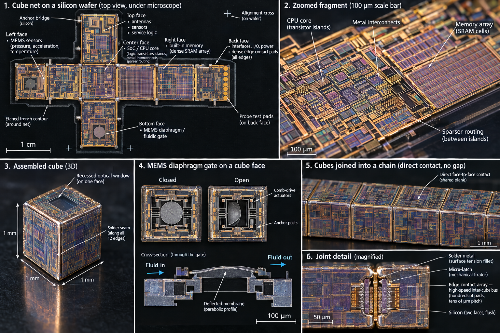

# Microreplicator

A modular micro-fab that builds copies of itself.

The target artefact is a hollow cube of about **1 mm** per side. Each cube carries one
function on its faces — logic, memory, sensors, power, a MEMS valve. Cubes snap into
chains and stacks, and a colony of cubes runs the process steps that produce the next
generation of cubes. There is no single master node: the colony is flat, like a
bacterial lawn, and every cube is replaceable.

The manufacturing idea that makes this reachable with DIY equipment is the **unfold**:
all six faces of the cube are patterned flat on one silicon wafer, the contour is cut
through the wafer, and the cross-shaped net folds itself into a cube. Every lithography,
deposition and etch step happens on a plane — the geometry only becomes 3D at the end.

*Vision artefact. Panel 1: the six-face net on a silicon wafer, 1 cm across. Panel 2: a
100 µm fragment of the circuitry. Panel 3: the folded cube, 1 mm edge. Panel 4: MEMS
diaphragm gate on a cube face. Panels 5–6: cubes joined into a chain and the solder
joint with its edge-contact bus.*

## Documents

| Document | What it covers |
|---|---|
| [docs/01-concept.md](docs/01-concept.md) | Operating principles: cube as the base module, seed and vitamins, face roles, inter-cube bus, flat probe test |
| [docs/02-cube-from-wafer.md](docs/02-cube-from-wafer.md) | How a cube is made: 2D net on a wafer, through-cut, self-folding, solder seams, generation 1 vs 2 |
| [docs/03-generational-stability.md](docs/03-generational-stability.md) | Why copies do not degrade: optical demagnification, bad-mirror maps, closed-loop overlay, and the limits that remain |
| [docs/04-diy-lithography-path.md](docs/04-diy-lithography-path.md) | The DIY lithography rig and the staged path from a bare DMD projector to PMOS and MEMS |
| [docs/05-roadmap.md](docs/05-roadmap.md) | Milestones and horizons: lithography gates, first transistor, micro-cell, sustained replication |

## The short version

1. **Start with a projection lithography rig**, not with a fab. A used DLP projector, a
   405 nm LED, a 10× long-working-distance objective and an achromatic doublet give a
  5–10× reduction and a measured pixel of about 0.75–1.5 µm on the sample. Diffraction
  at NA 0.25 puts the physical floor near 1.6 µm, so the first honest target is
  **2–5 µm** on a series, not 1 µm.
2. **Etch structures without a furnace.** TMAH bulk etching of silicon gives cantilevers,
   bridges and diaphragms with no sacrificial layer and no HF.
3. **Add a tube furnace** (about USD 100–300). One furnace unlocks thermal oxide, boron
   diffusion from spin-on dopant, and contact anneal — that is the whole PMOS gate.
4. **Fold the first cubes before you can fill them.** Generation 1 cubes are empty
   shells, 2–5 mm on a side, that need only contour lithography at 10–50 µm, through-etch,
   hinges and solder. No furnace, no transistors.
5. **Fill them later.** Generation 2 puts PMOS logic and MEMS on the inner faces of the
   net, probes the net flat, then folds and seals it.

The engineering position is deliberately conservative: the 2–5 µm process is a
*qualified* target at fixed equipment, not a promise. Everything below 1–2 µm is a
separate branch with new optics, and the file records where those walls are.

## Status

Concept and process design. The work behind these documents exists as a large body of
Russian-language engineering notes (photolithography bench design and CAD, MEMS process
levels, PMOS route, supply lists, safety review). This repository is the English-facing
summary: what the machine is, how it is made, why the copies stay good, and what a
person can actually start building this month.

## License

Documentation and images: [CC BY 4.0](LICENSE).
